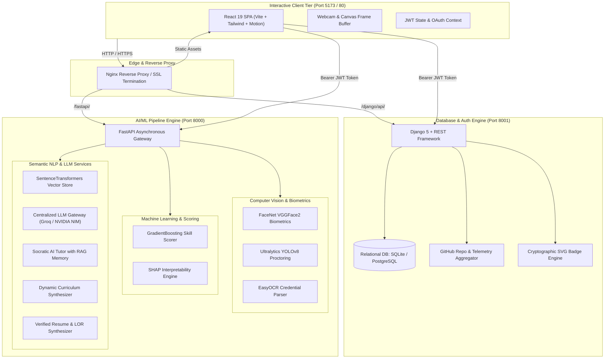

<div align="center">

# 🌟 Vidhya Praman (विद्या प्रमाण)
### *Next-Generation AI Platform for Biometric Verification, Intelligent Proctoring, Explainable Skill Scoring & Adaptive Learning*

[](https://www.python.org/)
[](https://fastapi.tiangolo.com/)
[](https://www.djangoproject.com/)
[](https://react.dev/)
[](https://vitejs.dev/)
[](https://pytorch.org/)
[](https://github.com/ultralytics/ultralytics)
[](LICENSE)

<br />

<p align="center">
  <a href="#-project-motive--philosophy">Project Motive</a> •
  <a href="#-key-use-cases">Use Cases</a> •
  <a href="#-system-architecture">Architecture</a> •
  <a href="#-the-9-aiml-core-pipelines">AI/ML Pipelines</a> •
  <a href="#-tech-stack">Tech Stack</a> •
  <a href="#-repository-structure">Project Structure</a> •
  <a href="#-getting-started">Getting Started</a> •
  <a href="#-documentation">Documentation</a>
</p>

</div>

---

## 🎯 Project Motive & Philosophy

In Sanskrit, **Vidhya Praman (विद्या प्रमाण)** signifies *"Valid Testimony and Verifiable Proof of Knowledge"*.

Modern digital education and technical recruitment suffer from a foundational trust crisis:
- **Credential Inflation & Forgery**: Resumes and claimed skill profiles frequently exaggerate expertise, making objective talent evaluation time-consuming and expensive.
- **Academic Dishonesty in Remote Testing**: Online assessments are susceptible to unauthorized assistance, secondary devices, and proxy test-takers.
- **Rigid, One-Size-Fits-All Curricula**: Traditional educational programs force students through fixed pacing, ignoring prior mastery or individual struggle areas.
- **Static, Amnesic Learning Tools**: Generic AI chat interfaces lack memory of a learner's historical misconceptions, past code submissions, or specific knowledge gaps.

**Vidhya Praman resolves this crisis by establishing an end-to-end, privacy-preserving, verifiable proof-of-competence ecosystem:**
1. **Verifiable Developer Identity**: Integrates biometric face matching and verified GitHub OAuth telemetry to ground user competence in genuine artifacts.
2. **Autonomous Integrity Enforcement**: Employs real-time computer vision (YOLOv8 & OpenCV) to detect multiple persons, unauthorized devices, and eye diversion during assessments—without recording or storing invasive video streams.
3. **Transparent & Explainable ML**: Uses Gradient Boosting with SHAP feature explainability to replace black-box evaluations with auditable skill confidence scores.
4. **Adaptive Pedagogical AI**: Pairs dynamic curriculum generation with a personalized Socratic 1:1 tutor powered by tenant-isolated RAG vector memory.

---

## 💡 Key Use Cases

| Stakeholder | Real-World Application | Value Delivered |
| :--- | :--- | :--- |
| 🎓 **Universities & Academics** | Remote proctored examinations, adaptive diagnostic evaluations, and hybrid grading. | Eliminates exam malpractice, automates subjective code grading, and prevents student impersonation. |
| 💼 **Tech Recruiters & HR** | Candidate skill auditing via GitHub telemetry, verified technical screening, and portfolio synthesis. | Reduces interview pipeline drop-off, detects fabricated resume claims, and generates verified LORs. |
| 🚀 **Self-Paced Learners** | Personalized learning paths, automated lesson generation, and persistent Socratic AI tutoring. | Eliminates learning plateaus through customized roadmaps and 24/7 contextual guidance. |
| 📜 **EdTech & Certification** | Optical Character Recognition for legacy certificates and tamper-evident digital SVG badge generation. | Provides cryptographic verification for certificates and automates credential digitization. |

---

## 🏛️ System Architecture

Vidhya Praman is architected as a high-performance, decoupled three-tier system:



---

## 🧠 The 9 AI/ML Core Pipelines

```
┌──────────────────────────────────────────────────────────────────────────────────┐
│                         VIDHYA PRAMAN AI/ML SERVICE SUITE                        │
├─────────────────────────┬──────────────────────────────┬─────────────────────────┤
│ 1. Identity Check       │ 2. Exam Proctoring           │ 3. Skill Confidence     │
│    FaceNet / VGGFace2   │    YOLOv8 + OpenCV Head Pose │    GradientBoosting ML  │
├─────────────────────────┼──────────────────────────────┼─────────────────────────┤
│ 4. Assessment Engine    │ 5. Learning Plan             │ 6. RAG Vector Memory    │
│    Adaptive MCQs + LLM  │    Dynamic Curriculum Synth  │    all-MiniLM-L6-v2     │
├─────────────────────────┼──────────────────────────────┼─────────────────────────┤
│ 7. Socratic AI Tutor    │ 8. Verified Doc Synthesis    │ 9. Certificate OCR      │
│    Episodic RAG Recall  │    Resume & LOR Generator    │    EasyOCR Text Parser  │
└─────────────────────────┴──────────────────────────────┴─────────────────────────┘
```

### 1. Biometric Identity Verification (`identity_check_model.py`)
- **Technology**: PyTorch, MTCNN (Multi-task Cascaded Convolutional Networks), InceptionResnetV1 (pretrained on VGGFace2).
- **Functionality**: Extracts a 512-dimensional facial embedding from webcam frames and performs 1:1 Euclidean and cosine distance matching against enrolled profiles.
- **Privacy First**: Operates purely in memory. Raw images and webcam frames are never persisted.

### 2. Intelligent Real-Time Exam Proctoring (`proctoring_model.py`)
- **Technology**: Ultralytics YOLOv8 nano (`yolov8n.pt`), OpenCV Haar Cascade / dlib face landmarks.
- **Detections**:
  - `no_face`: Flags examinee absence (>3 consecutive frames).
  - `multi_face`: Detects secondary persons or proxy test-takers.
  - `device_detected`: Identifies unauthorized objects (cellphones, laptops, books).
  - `gaze_diverted`: Estimates head yaw and pitch to detect persistent off-screen looking.

### 3. Developer Skill Confidence Scorer (`skill_confidence_model.py`)
- **Technology**: Scikit-Learn `GradientBoostingClassifier`, SHAP (SHapley Additive exPlanations).
- **Input Signals**: Ingests authentic GitHub telemetry (public repo count, 6-month commit velocity, language byte ratios, peer stars/forks, account age, and README completeness).
- **Output**: Calibrated confidence score $[0.0 - 1.0]$, proficiency category (`Novice` to `Master`), and transparent feature contribution weights.

### 4. Adaptive Assessment & Hybrid Grading (`assessment_model.py`)
- **Technology**: NVIDIA DeepSeek v4 Flash / Groq LLMs + deterministic grading engine.
- **Engine**:
  - Generates topic-grounded, multi-tiered MCQs and complex short-answer prompts.
  - **Hybrid Grading**: Constant-time exact key matching for MCQs combined with LLM rubric analysis for conceptual short answers.

### 5. Hierarchical Learning Plan Generator (`learning_plan_model.py`)
- **Technology**: DeepSeek LLM + Directed Acyclic Graph (DAG) dependency solver.
- **Functionality**: Synthesizes structured, milestone-oriented multi-week curricula based on learner target roles, timeframe goals, and baseline diagnostic scores.

### 6. Semantic RAG Retrieval Vector Store (`rag_retrieval_model.py`)
- **Technology**: Sentence-Transformers (`all-MiniLM-L6-v2`), NumPy vectorized cosine similarity.
- **Architecture**: In-memory dense semantic search with **tenant-isolated namespaces** (`user_id` segregation) to prevent cross-learner memory contamination.

### 7. Conversational 1:1 Socratic AI Tutor (`tutoring_model.py`)
- **Technology**: Multi-Provider LLM Gateway + Semantic Memory Injection.
- **Functionality**: Queries the student's personal vector store for historical misconceptions, provides guided Socratic hints without spoiling solutions, and commits conversation insights back to memory.

### 8. Verified Document Synthesis (`document_generation_model.py`)
- **Technology**: Prompt-engineered LLM synthesis engine.
- **Functionality**: Synthesizes verified Markdown resumes and formal Letters of Recommendation (LOR) grounded solely in confirmed platform achievements and authenticated GitHub projects.

### 9. Certificate OCR & Extraction Engine (`certificate_ocr_model.py`)
- **Technology**: EasyOCR (PyTorch OCR pipeline) + RegEx heuristic entity extraction.
- **Functionality**: Digitizes scanned diplomas, badges, and certificates—extracting recipient name, credential title, issuing organization, and completion dates.

---

## 💻 Tech Stack

| Domain | Technologies Used |
| :--- | :--- |
| **Frontend** | React 19, Vite 8, Tailwind CSS 3.4, Framer Motion, Lucide Icons, Canvas Confetti |
| **Backend (Core & DB)** | Django 5, Django REST Framework, SQLite / PostgreSQL, PyJWT, Cryptography |
| **Backend (AI Services)** | FastAPI 0.110+, Uvicorn, Pydantic v2, Python-Multipart |
| **Computer Vision** | OpenCV 4.9, Pillow, Ultralytics YOLOv8, FaceNet-PyTorch |
| **Deep Learning & ML** | PyTorch 2.0+ (CPU/CUDA), Scikit-Learn, SciPy, NumPy, Pandas, SHAP |
| **NLP & Vectors** | Sentence-Transformers (`all-MiniLM-L6-v2`), EasyOCR |
| **LLM Inference** | Groq API (`openai/gpt-oss-120b`), NVIDIA NIM (`deepseek-v4-flash`, `llama-3.3-70b`), OpenAI |
| **DevOps & Cloud** | Docker, Docker Compose, Nginx, Systemd, AWS EC2 (Free Tier `t2.micro`) |

---

## 📁 Repository Structure

```
VidhyaPraman/
├── deploy/                          # Production deployment assets
│   ├── Dockerfile.django            # Container recipe for Django backend
│   ├── Dockerfile.fastapi           # Container recipe for FastAPI AI engine
│   ├── nginx.conf                   # Reverse proxy configuration
│   ├── setup_aws_ec2.sh             # 1-click automated AWS EC2 setup script
│   ├── vidhyapraman-django.service  # Systemd daemon for Django
│   └── vidhyapraman-fastapi.service # Systemd daemon for FastAPI
├── docs/                            # Documentation suite
│   ├── ARCHITECTURE.md              # Detailed architectural specifications & sequence diagrams
│   ├── API_REFERENCE.md             # Complete FastAPI & Django REST API reference
│   ├── DEPLOYMENT.md                # Deployment overview & operational instructions
│   └── AWS_FREE_TIER_DEPLOYMENT_GUIDE.md # 100% Free AWS deployment guide
├── frontend/                        # React 19 + Vite Frontend SPA
│   ├── src/
│   │   ├── components/              # Modular UI components & webcam wrappers
│   │   ├── context/                 # AuthContext & global state management
│   │   ├── services/                # Axios/Fetch API client connectors
│   │   ├── views/                   # Feature studios (Assessment, Proctoring, Tutor, etc.)
│   │   └── App.jsx                  # Main routing & application layout
│   ├── package.json                 # Node dependencies
│   └── vite.config.js               # Vite build configuration
├── server_django/                   # Django Relational & Auth Subsystem
│   ├── accounts/                    # Core accounts app
│   │   ├── models.py                # UserProfile, ModuleLesson, ProctoringSession entities
│   │   ├── jwt_service.py           # HMAC-SHA256 JWT generation and validation
│   │   ├── oauth_service.py         # Google & GitHub OAuth handlers
│   │   ├── github_service.py        # GitHub API repository synchronizer
│   │   ├── badge_service.py         # Tamper-proof SVG badge generator
│   │   └── views.py                 # REST API endpoints
│   └── manage.py                    # Django administration entrypoint
├── tests/                           # Unified automated test suites
│   ├── __init__.py                  # Tests package marker
│   ├── master_system_audit.py       # End-to-end 22-point master system audit
│   ├── test_api.py                  # FastAPI OpenAPI & endpoint verification
│   ├── test_auth_foundation.py      # OAuth2 & JWT integration tests
│   ├── test_proctoring_service.py   # YOLOv8 & OpenCV proctoring tests
│   └── ...                          # Domain-specific unit test suites
├── api_schemas.py                   # Pydantic v2 schemas for all AI/ML models
├── app.py                           # Application entrypoint alias
├── main.py                          # FastAPI unified application & Swagger UI
├── llm_client.py                    # Multi-provider LLM gateway
├── *_model.py                       # 9 Specialized AI/ML model pipeline modules
├── requirements.txt                 # Master Python dependencies specification
├── docker-compose.yml               # Multi-container orchestration specification
├── start_all.bat                    # 1-click Windows multi-process launcher
├── .env.example                     # Environment variables configuration template
└── README.md                        # Master project documentation
```

---

## 🚀 Getting Started

### Prerequisites
- **Python**: `3.11` or `3.12` (Python 3.12 recommended)
- **Node.js**: `18.x` or `20.x LTS` & `npm`
- **Git**

### 1. Clone the Repository
```bash
git clone https://github.com/shanmukh-1914/VidhyaPraman.git
cd VidhyaPraman
```

### 2. Configure Environment Variables
Copy the template `.env.example` into `.env` and provide your API keys:
```bash
cp .env.example .env
```
*(At minimum, specify your preferred LLM key, e.g., `GROQ_API_KEY` or `NVIDIA_API_KEY`)*.

---

### 3. Launching Locally

#### Option A: 1-Click Windows Launcher (Fastest)
Double-click or run from Command Prompt:
```cmd
start_all.bat
```
This automatically initiates:
- 🟢 **Django Engine**: `http://127.0.0.1:8001`
- 🟢 **FastAPI AI Server**: `http://127.0.0.1:8000`
- 🟢 **React Frontend**: `http://localhost:5173`

---

#### Option B: Manual Multi-Terminal Setup

**Terminal 1 — FastAPI AI Engine**:
```bash
python -m venv .venv
source .venv/bin/activate       # On Windows: .venv\Scripts\activate
pip install -r requirements.txt
python -m uvicorn main:app --host 0.0.0.0 --port 8000 --reload
```
*Interactive Swagger UI is available at `http://localhost:8000/docs`.*

**Terminal 2 — Django Database & Auth**:
```bash
cd server_django
python manage.py migrate
python manage.py runserver 0.0.0.0:8001
```

**Terminal 3 — React Frontend**:
```bash
cd frontend
npm install
npm run dev
```
*Frontend interface is available at `http://localhost:5173`.*

---

## 🧪 Testing & System Audit

To execute the master end-to-end system audit across all database entities, auth mechanisms, and AI pipelines:

```bash
# Execute master system audit
python tests/master_system_audit.py

# Execute FastAPI endpoint verification
python tests/test_api.py

# Execute proctoring service tests
python tests/test_proctoring_service.py
```

---

## 🌐 Production Deployment

Vidhya Praman can be deployed via Docker Compose or on a free cloud instance:

- **Docker Compose**:
  ```bash
  docker compose up -d --build
  ```
- **AWS Free Tier Deployment ($0/month)**:  
  Follow the comprehensive guide in [`docs/AWS_FREE_TIER_DEPLOYMENT_GUIDE.md`](docs/AWS_FREE_TIER_DEPLOYMENT_GUIDE.md) to deploy on a `t2.micro` EC2 instance with automated 4GB swap space and CPU-optimized PyTorch.

---

## 📚 Documentation

Detailed documentation is organized in the [`docs/`](docs/) directory:
- [🏛️ System Architecture Specification](docs/ARCHITECTURE.md)
- [📡 API Reference & Schemas](docs/API_REFERENCE.md)
- [🚀 Deployment & Operations Guide](docs/DEPLOYMENT.md)
- [☁️ AWS Free Tier ($0 Cost) Guide](docs/AWS_FREE_TIER_DEPLOYMENT_GUIDE.md)
- [⚛️ Frontend Overview](frontend/README.md)

---

## 🔒 Security & Privacy Guarantees

1. **Zero Raw Video Retention**: Facial biometric vectors and proctoring frames are processed transiently in volatile memory and immediately discarded.
2. **Stateless Authentication**: Cryptographic HMAC-SHA256 JWT tokens secure both API layers without inter-service database locks.
3. **Tenant-Isolated Memory**: Vector embeddings are strictly keyed by unique user identifiers, preventing any cross-learner data exposure.

---

## 📄 License

This project is licensed under the [MIT License](LICENSE) — see the LICENSE file for details.
