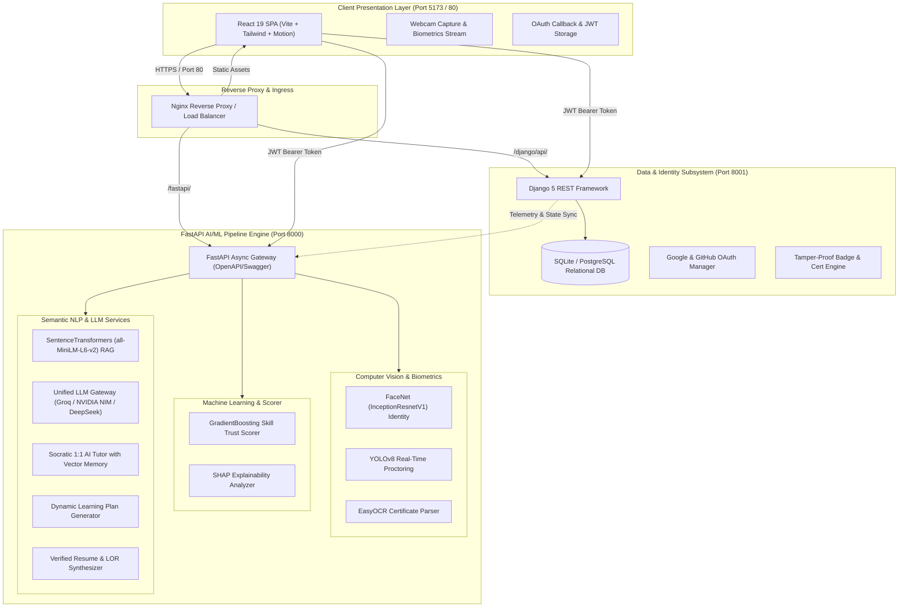
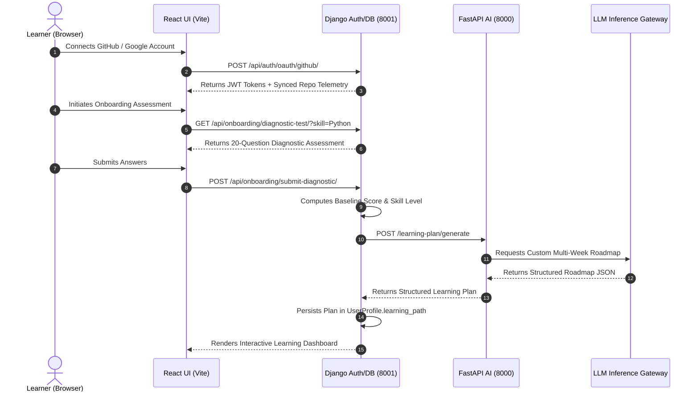
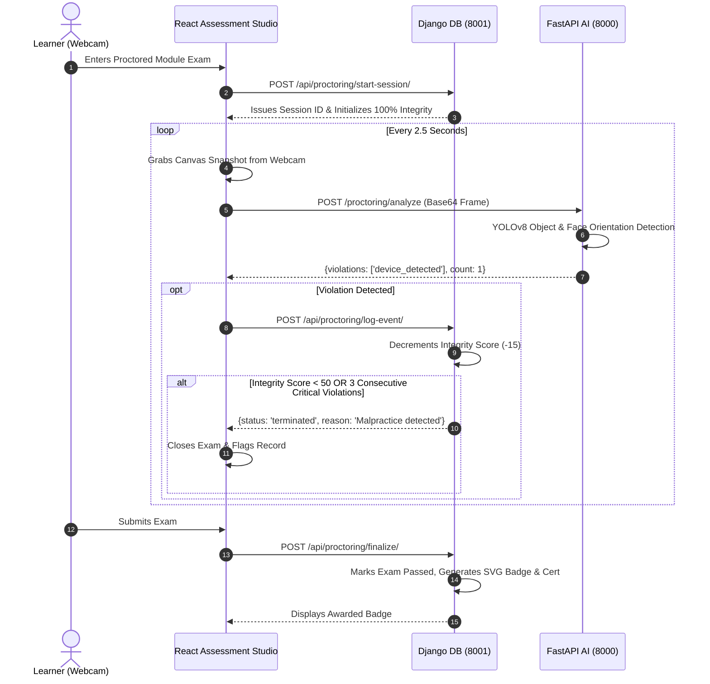

# 🏛️ Vidhya Praman — System Architecture & Technical Specification

> **Vidhya Praman (विद्या प्रमाण)**: Sanskrit for *"Valid Testimony and Verifiable Proof of Knowledge"*.  
> A distributed, privacy-first, enterprise-grade AI ecosystem integrating computer vision biometrics, deep learning exam proctoring, explainable machine learning skill scoring, retrieval-augmented generation (RAG), dynamic curriculum planning, and verified credential management.

---

## 1. High-Level Distributed Architecture

Vidhya Praman is structured as a decoupled, multi-tier service platform consisting of three primary components:
1. **Interactive Client Tier**: React 19 Single Page Application built on Vite, Tailwind CSS, and Framer Motion.
2. **Persistence & Identity Tier**: Django 5 + Django REST Framework powering relational data persistence, OAuth2/JWT auth, GitHub profile synchronization, and verifiable credentials.
3. **AI/ML Pipeline Tier**: FastAPI asynchronous inference server hosting 9 independent computer vision, deep learning, NLP, and LLM micro-services.



---

## 2. Subsystem Breakdown

### Subsystem A: Django Database & Identity Engine (Port 8001)
- **Role**: Serves as the immutable single source of truth for learner profiles, activity streams, and verifiable credentials.
- **Key Modules**:
  - `accounts/models.py`: Defines `UserProfile` (central graph entity), `UserActivityRecord` (audit trail), `ModuleLessonContent` (persisted AI curriculum modules), and `ProctoringSessionRecord` (tamper-evident exam session logs).
  - `accounts/jwt_service.py`: Generates and validates cryptographic HMAC-SHA256 JWT access and refresh tokens shared across Django and FastAPI.
  - `accounts/oauth_service.py`: Orchestrates Google OAuth 2.0 and GitHub OAuth flows. Merges linked identities into a single persistent profile.
  - `accounts/github_service.py`: Fetches authenticated developer repository telemetry (stars, languages, commit velocity, repo quality) to feed the skill confidence model.
  - `accounts/badge_service.py`: Dynamically generates cryptographically signed SVG badges and credential records upon exam completion.
  - `accounts/module_service.py` & `onboarding_service.py`: Manages prerequisite trees, module unlocking, lesson caching, and 20-question diagnostic assessments.

### Subsystem B: FastAPI AI/ML Pipeline Engine (Port 8000)
- **Role**: Stateless, high-throughput asynchronous execution of heavy computer vision, ML, and generative AI pipelines.
- **Key Modules**:
  - `main.py`: ASGI entrypoint with automated OpenAPI 3.0 documentation (`/docs`, `/redoc`), global CORS handling, and Pydantic validation.
  - `api_schemas.py`: Strictly typed request and response data models ensuring contract fidelity.
  - `llm_client.py`: Multi-provider gateway featuring fallback routing between Groq (low-latency inference), NVIDIA NIM (DeepSeek v4 Flash, Llama 3.3 70B), OpenAI, Anthropic Claude, and Gemini.

### Subsystem C: React 19 Neural Frontend (Port 5173)
- **Role**: Fluid, highly responsive interface for learners, proctors, and administrators.
- **Key Views & Components**:
  - `AuthPortal.jsx`: Unified login and registration supporting Google, GitHub, and local credentials.
  - `Dashboard.jsx`: Learner command center displaying learning streaks, verified skills, and module progression.
  - `AssessmentStudio.jsx`: Timed assessment interface with integrated webcam proctoring and real-time grading.
  - `ProctoringStudio.jsx`: Live computer vision monitor highlighting object detection bounding boxes, face orientation, and violation logs.
  - `IdentityCheck.jsx`: Biometric verification onboarding portal with live facial landmark detection.
  - `TutorStudio.jsx`: 1:1 conversational tutor with Markdown rendering, math formula formatting, and contextual recall.
  - `ModuleStudio.jsx`: Hierarchical module explorer with interactive code assignments and sandbox execution.
  - `CertificateOCR.jsx`: Drag-and-drop credential scanner extracting issuer, recipient, and issue dates via client-driven OCR requests.
  - `DocumentStudio.jsx`: Instant generator for verified Markdown/PDF resumes and recommendation letters based solely on validated platform achievements.

---

## 3. Deep Dive: The 9 AI/ML Model Pipelines

```
┌──────────────────────────────────────────────────────────────────────────────────┐
│                             9 VIDHYA PRAMAN AI SERVICES                          │
├─────────────────────────┬──────────────────────────────┬─────────────────────────┤
│ 1. Identity Check       │ 2. Exam Proctoring           │ 3. Skill Confidence     │
│    FaceNet / VGGFace2   │    YOLOv8 + OpenCV Head Pose │    GradientBoosting ML  │
├─────────────────────────┼──────────────────────────────┼─────────────────────────┤
│ 4. Assessment Engine    │ 5. Learning Plan             │ 6. RAG Vector Memory    │
│    Adaptive MCQs + LLM  │    Dynamic Curriculum Synth  │    all-MiniLM-L6-v2     │
├─────────────────────────┼──────────────────────────────┼─────────────────────────┤
│ 7. Socratic AI Tutor    │ 8. Verified Doc Synthesis    │ 9. Certificate OCR      │
│    Episodic RAG Recall  │    Resume & LOR Generator    │    EasyOCR Text Parser  │
└─────────────────────────┴──────────────────────────────┴─────────────────────────┘
```

### 1. Biometric Identity Verification (`identity_check_model.py`)
- **Underlying Technology**: PyTorch, MTCNN (Multi-task Cascaded Convolutional Networks), and InceptionResnetV1 pretrained on VGGFace2.
- **Workflow**:
  1. Accepts base64-encoded webcam frames or multipart image uploads.
  2. Detects and extracts normalized $160 \times 160$ aligned face crops.
  3. Computes a 512-dimensional continuous facial embedding vector.
  4. Measures Euclidean distance $D(e_1, e_2) = \|e_1 - e_2\|_2$ and cosine similarity against reference enrollment images.
  5. Distance threshold $\le 0.85$ confirms identity match; ephemerally discards raw image bytes to comply with biometric privacy regulations.

### 2. Intelligent Exam Proctoring (`proctoring_model.py`)
- **Underlying Technology**: Ultralytics YOLOv8 nano (`yolov8n.pt`), OpenCV Haar Cascade / dlib face landmarks.
- **Detection Capabilities**:
  - **Absence Detection (`no_face`)**: Triggered when 0 persons/faces are present in the video stream for $>3$ consecutive frames.
  - **Multiple Persons (`multi_face`)**: Triggered when $\ge 2$ human faces or persons are detected simultaneously.
  - **Unauthorized Devices (`device_detected`)**: Real-time object bounding box detection for mobile phones (class 67), laptops (class 63), and books (class 73).
  - **Gaze / Head Pose Deviation**: Tracks horizontal yaw and vertical pitch angles; flags suspicious off-screen viewing patterns.

### 3. Developer Skill Confidence Scorer (`skill_confidence_model.py`)
- **Underlying Technology**: Scikit-Learn `GradientBoostingClassifier` / `RandomForestClassifier`, SHAP (SHapley Additive exPlanations).
- **Features Ingested**:
  - Total public repositories in target technology
  - 6-month commit velocity and frequency
  - Direct programming language byte distribution match
  - Community peer endorsements and code review count
  - Account maturity / tenure (years)
  - Documentation and README quality score (structure, length, completeness)
- **Output**: Calibrated confidence score $[0.0 - 1.0]$, categorical proficiency band (`Novice`, `Competent`, `Expert`, `Master`), and SHAP feature importance vectors for transparent score explainability.

### 4. Adaptive Assessment & Hybrid Grading (`assessment_model.py`)
- **Underlying Technology**: NVIDIA DeepSeek v4 Flash / Groq LLMs + deterministic rule engine.
- **Capabilities**:
  - Synthesizes topic-grounded, multi-difficulty multiple choice questions (MCQs) and complex short-answer questions.
  - **Hybrid Grading Strategy**:
    - **MCQ Evaluation**: $100\%$ deterministic constant-time key validation.
    - **Short Answer Evaluation**: Socratic LLM evaluation grading against strict rubrics (conceptual accuracy, code syntax, edge-case coverage).

### 5. Hierarchical Learning Plan Generator (`learning_plan_model.py`)
- **Underlying Technology**: DeepSeek LLM + Directed Acyclic Graph (DAG) dependency solver.
- **Functionality**: Generates customized study roadmaps tailored to goal durations (e.g., 4, 8, 12 weeks), target roles, and baseline diagnostic scores. Organizes weekly modules with clear learning objectives, curated resources, and milestone checkpoints.

### 6. Semantic RAG Retrieval Vector Store (`rag_retrieval_model.py`)
- **Underlying Technology**: SentenceTransformers (`all-MiniLM-L6-v2`), NumPy vectorized cosine similarity.
- **Architecture**:
  - Embeds arbitrary textual passages into normalized 384-dimensional dense vectors.
  - Features **tenant-isolated namespaces** (`user_id` partitioning) preventing cross-account memory leakage.
  - Supports batch insertion, cosine similarity indexing, and semantic text retrieval under 15ms.

### 7. Conversational 1:1 Socratic AI Tutor (`tutoring_model.py`)
- **Underlying Technology**: LLM Gateway + Semantic Memory Injection.
- **Workflow**:
  1. Receives student query or code struggle.
  2. Queries the RAG store for historical misconceptions or previous module failures.
  3. Formulates a guided, Socratic response encouraging problem-solving without revealing full solutions prematurely.
  4. Asynchronously commits key takeaways back to the user's vector store for future recall.

### 8. Verified Document Synthesis (`document_generation_model.py`)
- **Underlying Technology**: LLM synthesis engine grounded on verified platform telemetry.
- **Functionality**:
  - Compiles authenticated profile data (verified GitHub repos, proctored exam scores, certified skills).
  - Generates tamper-evident **Markdown Resumes** and formal **Letters of Recommendation (LOR)** signed with platform cryptographic verification hashes.

### 9. Certificate OCR & Extraction Engine (`certificate_ocr_model.py`)
- **Underlying Technology**: EasyOCR (PyTorch-backed deep optical character recognition) + RegEx heuristic entity extraction.
- **Capabilities**: Parses scanned certificates, diplomas, and digital badges; automatically extracts credential titles, issuing bodies, recipient names, and completion dates with confidence percentages.

---

## 4. End-to-End System Workflows

### Learner Diagnostic & Roadmap Generation Sequence



### Proctored Exam & Malpractice Enforcement Sequence



---

## 5. Security & Academic Integrity Model

1. **Ephemeral Biometric Processing**: Biometric face matching vectors are calculated in memory. Raw images and webcam feeds are never persisted to disk or databases, strictly adhering to global privacy frameworks (GDPR, FERPA, CCPA).
2. **Stateless Multi-Service JWT Verification**: A shared cryptographic secret key allows both Django and FastAPI to validate user identity without inter-service RPC overhead.
3. **Tenant Memory Sandboxing**: Vector store indices are strictly segregated by `user_id`. An assessment or tutor chat query can never retrieve contextual documents from other learners.
4. **Tamper-Evident Certification Signatures**: Badges and generated diplomas carry cryptographic SHA-256 hashes generated from the learner's immutable exam telemetry, preventing forgery.
